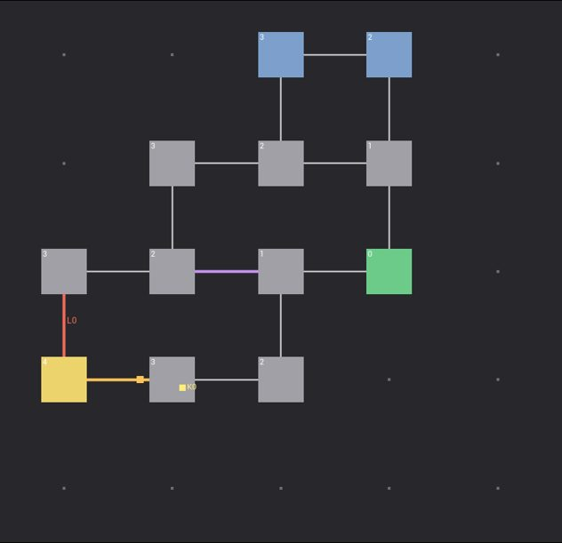

# NsDungeons Tech Documentation

## Modules

| Module | Type | Content |
|---|---|---|
| `NsDungeons` | Runtime | The graph, the rule set, the generator, the validation, the tests |
| `NsDungeonsEditor` | Editor | The NsDungeons Preview tab: `SNsDungeonPreview` (controls) and `SNsDungeonView` (paints a graph step or the layout). The `NsDungeons.SavePreview` command renders the preview off screen with `FWidgetRenderer` |

The runtime module depends on Core, CoreUObject, and Engine only.

## Data

| Type | Role |
|---|---|
| `FNsDungeonGraph` | A fixed grid of `FNsDungeonNode`, a list of `FNsDungeonEdge` between grid neighbors, and the `FNsDungeonLock` and `FNsDungeonKey` lists. Node index = `Y * Size.X + X` |
| `FNsDungeonEdge` | Two nodes, a kind (`Open`, `Locked`, `OneWay`, `Hidden`), the lock id of a locked edge, and the node that a one-way edge opens from |
| `FNsDungeonLock` | A locked edge and every key id that it needs. A lock with no key never opens |
| `FNsDungeonKey` | The node that holds the key, and its lock |
| `FNsDungeonSettings` | The values of one generation. `UNsDungeonRuleSet` holds them in an asset |
| `FNsDungeonResult` | The seed that worked, the validity, a message, the graph, and the steps |

## The generation

`FNsDungeonGenerator::Generate` runs `TryGenerate` with `FRandomStream(Seed + Try)` until a try passes `Validate`.

1. **Grid.** `Reset` makes every node `Unused`.
2. **Start and goal.** A random start, and a random goal at the minimum grid distance or more.
3. **Major cycle.** `FindGridPath` is Dijkstra with a random cost on each node, so the path wanders. Arc 0 goes from the start to the goal. Arc 1 does the same around the inner nodes of arc 0. A direct step from the start to the goal is not allowed, so each arc has a node between them. The arcs become `Path` nodes and `Open` edges.
4. **Cycle type.** `PickCycleType` picks by weight. `ApplyCycleType` puts a lock on the last edge of arc 0 into the goal, keys on the arcs, and a one-way edge from the goal into arc 1 for the valve types.
5. **Minor cycles** (`NsDungeonSteps.cpp`). From a room, 1 to 3 unused nodes, back into another room. By chance, a lock at the entry, a one-way door out, and the key in a room of the dungeon. The validation is the judge: a key that cannot be reached takes the lock back off.
6. **Hidden shortcut.** By chance, a `Hidden` edge between the two grid neighbors with the largest gap in doors from the start (more than 2).
7. **Dead ends.** New rooms next to rooms (not the goal) until `TargetRooms`.
8. **Resolve.** `Distance` from the start, `bDeadEnd`, and the room tags by place.
9. **Validation.** A walk from the start over the edges that `CanPass` allows. Each reached key goes into the held set, and the walk runs again until nothing changes. Valid when the goal and every key are reached, and each lock matters: with its keys held back, some room is out of reach. A lock that a second way goes around fails the seed.

A lock marks the rooms behind it with `LockedArea` (the goal for a major lock, the side loop for a minor lock). The later steps never start a side loop or a hidden door from such a room, so they cannot make a way around the lock.

With `bKeepSteps`, each step stores a copy of the graph in `Result.Steps` for the editor preview.

## The layout

`BuildLayout` (`NsDungeonLayoutBuilder.cpp`) runs after a valid graph, with its own random stream from the seed. Each node owns a block of `RoomCellsMax` cells, and `CorridorCells` of rock lie between blocks. A room takes a random size from `RoomCellsMin` to `RoomCellsMax` and sits in the middle of its block, so the middle row and the middle column of a block cross its room. The corridor of an edge runs straight along that line from room A to room B, and its middle cell is the door, with the kind of the edge and the direction from A to B.

`UNsDungeonLibrary` gives the Blueprint calls: generate, read a cell, cell to local, local to cell.

`UNsDungeonDebugComponent` draws the layout with debug lines and strings each frame, in the space of its owner, while the console variable `NsDungeons.ShowDebug` is not 0. It keeps a copy of the result.

## Extension points

- A new major cycle type: add it to `ENsDungeonCycleType` and a case in `ApplyCycleType`. The validation checks it with no other change.
- A new step: a static function of `FNsDungeonGenerator` in `NsDungeonSteps.cpp`, called from `TryGenerate`, with a `KeepStep` after it.

## Tests

`Private/Tests/NsDungeonGeneratorTests.cpp`:

| Test | Checks |
|---|---|
| `NsDungeons.Generator.CycleTypes` | 200 seeds for each cycle type: valid, the right locks and keys |
| `NsDungeons.Generator.LockBlocksGoal` | Without its keys, a lock and key dungeon has no way to the goal |
| `NsDungeons.Generator.SameSeed` | The same seed gives the same graph, and the steps end on the result |
| `NsDungeons.Generator.FullFloor` | 200 seeds with every step on: valid, the target size, a side loop, every tag placed, most floors with a locked side loop |
| `NsDungeons.Layout.Rooms` | 100 layouts: a room for each node, no rooms that touch, a door for each edge, every room reached over the cells |
| `NsDungeons.Generator.Validate` | A hand-made graph: a lock with no key, a key next to the start, a one-way door from the goal side |
